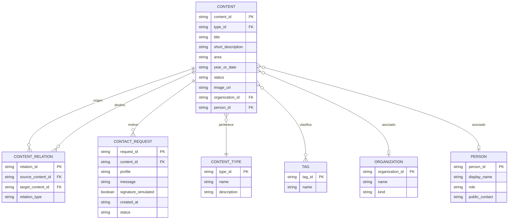

# 05. Versión preliminar del modelo de datos

## 1. Alcance del modelo

El modelo representa la información mínima necesaria para el MVP Explorador CIM UC. Todos los registros serán ficticios, sintéticos, públicos o anonimizados. No se modelan credenciales ni datos productivos.

## 2. Diagrama de dominio



## 3. Entidades y atributos

### CONTENT - Contenido

- `content_id`: identificador interno, por ejemplo `P-01`.
- `type_id`: tipo de contenido.
- `title`: título visible.
- `short_description`: descripción breve.
- `area`: área temática o capacidad I+D.
- `year_or_date`: año, fecha o vigencia.
- `status`: estado del proyecto, actividad o publicación.
- `image_url`: recurso público o ficticio opcional.
- `organization_id`: organización asociada opcional.
- `person_id`: integrante asociado opcional.

### CONTENT_TYPE - Tipo de contenido

Valores iniciales: Proyecto, Capacidad I+D, Integrante, Publicación, Actividad, Formación y Colaboración.

### TAG - Etiqueta

Permite clasificar contenidos por temas como Construcción, Circularidad, Materiales, Comunidad o Formación.

### CONTENT_RELATION - Relación entre contenidos

Relaciona dos contenidos del catálogo. Ejemplos: “proyecto utiliza capacidad”, “publicación documenta proyecto” o “actividad presenta proyecto”.

- `source_content_id`: contenido de origen.
- `target_content_id`: contenido relacionado.
- `relation_type`: descripción de la relación.

### ORGANIZATION - Organización

Representa una institución pública, empresa, universidad o centro asociado cuando sea necesario para el escenario de prueba.

### PERSON - Integrante

Representa un integrante ficticio, público o anonimizado. En el MVP se podrá mostrar como contenido tipo Integrante sin datos personales no públicos.

### CONTACT_REQUEST - Solicitud simulada

Representa la intención de contacto dentro del escenario académico.

- `profile`: perfil seleccionado por la persona usuaria.
- `message`: motivo escrito.
- `signature_simulated`: indica si se marcó la simulación.
- `created_at`: fecha y hora local de prueba.
- `status`: inicialmente `simulada`.

## 4. Ejemplo de registros

```json
{
  "content_id": "P-01",
  "type_id": "project",
  "title": "Bosque Urbano Modular",
  "short_description": "Sistema constructivo de baja huella para densificar barrios con madera local.",
  "area": "Construcción y circularidad",
  "year_or_date": "2026",
  "status": "En desarrollo",
  "related_content_ids": ["M-03", "C-02", "A-01"]
}
```

## 5. Trazabilidad con la solución

- La búsqueda y los filtros usan `CONTENT`, `CONTENT_TYPE` y `TAG`.
- La pantalla de detalle usa los atributos de `CONTENT`.
- La sección “Conectado con” usa `CONTENT_RELATION`.
- El formulario de contacto crea un registro `CONTACT_REQUEST` simulado.
- El modelo permite incorporar nuevos tipos y relaciones sin alterar el flujo principal.
