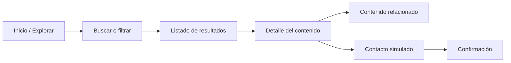

# 06. Mockups de la aplicación

## Explorador CIM UC

Los siguientes mockups representan la versión preliminar de la aplicación y el flujo principal del MVP. Se diseñan primero para móvil, con adaptación a tablet y computador.

## 1. Flujo principal



## 2. Pantalla Inicio / Explorar

```text
┌──────────────────────────────┐
│  ◯ CIM UC                 JR  │
├──────────────────────────────┤
│  INVESTIGACIÓN QUE TOMA FORMA│
│                              │
│  Encuentra lo que             │
│  PODEMOS CONSTRUIR.           │
│                              │
│  Explora proyectos, capacidades│
│  y personas del CIM UC.       │
│                              │
│  ⌕ Buscar proyectos...        │
├──────────────────────────────┤
│  DESCUBRIMIENTO               │
│  Explora el centro      Ver todo│
│                              │
│  [Todo] [Proyectos] [Capac.]  │
│                              │
│  8 resultados                 │
│  ┌──────────┐ ┌──────────┐   │
│  │ PROYECTO │ │ CAPACIDAD│   │
│  │ Bosque   │ │ Diseño y │   │
│  │ Urbano   │ │ cálculo  │   │
│  └──────────┘ └──────────┘   │
│                              │
├──────────────────────────────┤
│   Explorar    Guardados  ↗    │
└──────────────────────────────┘
```

**Interacciones:** búsqueda, filtros por categoría y selección de tarjetas.

## 3. Pantalla Listado filtrado

```text
┌──────────────────────────────┐
│ ← Explorar       Proyectos   │
├──────────────────────────────┤
│ 2 resultados                 │
│                              │
│ ┌──────────────────────────┐ │
│ │ P-01                     │ │
│ │ Bosque Urbano Modular ↗  │ │
│ │ En desarrollo · 2026     │ │
│ └──────────────────────────┘ │
│                              │
│ ┌──────────────────────────┐ │
│ │ P-04                     │ │
│ │ Madera que regenera ↗    │ │
│ │ Piloto · 2025            │ │
│ └──────────────────────────┘ │
└──────────────────────────────┘
```

## 4. Pantalla Detalle de contenido

```text
┌──────────────────────────────┐
│                         ×    │
│   PROYECTOS              P-01 │
│   [recurso visual ficticio]  │
├──────────────────────────────┤
│ 2026 · EN DESARROLLO         │
│ Bosque Urbano Modular        │
│                              │
│ Sistema constructivo de baja │
│ huella para densificar       │
│ barrios con madera local.    │
│                              │
│ [Construcción] [Circularidad]│
│                              │
│ CONECTADO CON      3 vínculos│
│ ┌──────────────────────────┐ │
│ │ Laboratorio de Sistemas ›│ │
│ │ Integrantes              │ │
│ └──────────────────────────┘ │
│ ┌──────────────────────────┐ │
│ │ Diseño y cálculo      ›  │ │
│ │ Capacidades I+D          │ │
│ └──────────────────────────┘ │
│                              │
│ [      Quiero conectar  ↗  ] │
└──────────────────────────────┘
```

## 5. Pantalla Contacto simulado

```text
┌──────────────────────────────┐
│                         ×    │
│  ↗  CONEXIÓN SIMULADA        │
│                              │
│  Cuéntanos qué te interesa   │
│  El equipo podrá orientarte. │
│                              │
│  Tu perfil                   │
│  [Selecciona una opción  ⌄]  │
│                              │
│  Motivo de contacto          │
│  [Me interesa conocer más...]│
│                              │
│  □ Simular firma electrónica │
│    avanzada                  │
│                              │
│  [      Enviar solicitud → ] │
└──────────────────────────────┘
```

## 6. Pantalla Confirmación

```text
┌──────────────────────────────┐
│                              │
│              ✓               │
│        Señal recibida        │
│                              │
│ Registramos tu interés en    │
│ este escenario de prueba.   │
│                              │
│ [      Volver a explorar    ]│
└──────────────────────────────┘
```

## 7. Criterios visuales

- Diseño mobile-first, con tarjetas y controles cómodos para interacción táctil.
- Navegación inferior persistente en móvil.
- Adaptación a tablet y computador mediante grilla responsive.
- Contraste entre fondo verde oscuro, acentos lima y superficies claras.
- Cada pantalla mantiene el mismo nombre de contenidos, identificadores y relaciones definidos en el modelo de datos.
- La etiqueta “Conexión simulada” evita confundir el MVP con un servicio institucional real.
